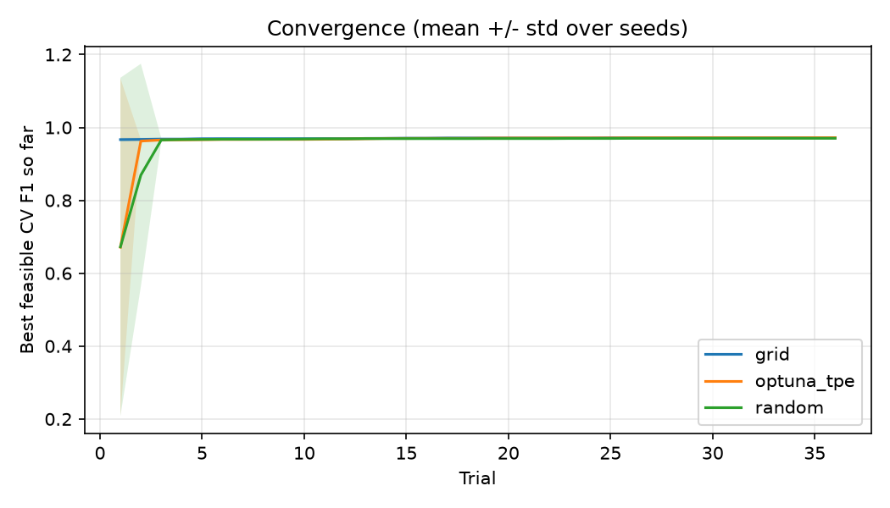
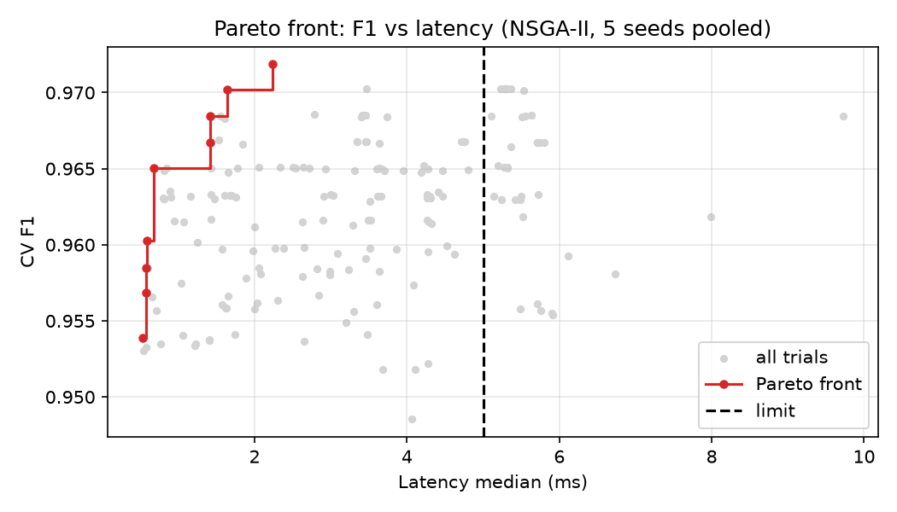
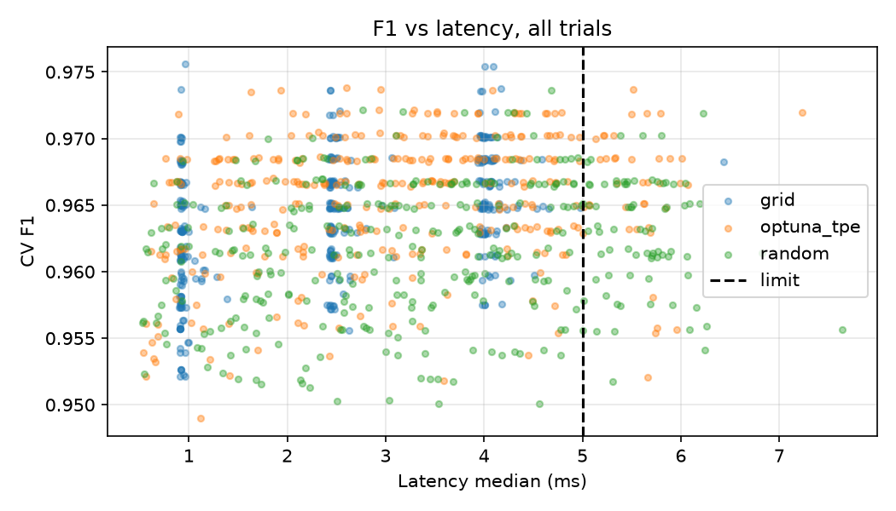

# Accuracy-Latency Optimization of Random Forest Hyperparameters

Hyperparameter optimization of a Random Forest classifier on the Breast Cancer Wisconsin dataset, comparing Grid Search, Random Search and Optuna (TPE) under a prediction-latency constraint.

> Status: v1.0 (final submission). Full report: report/BaoCao_NhapMonToiUuHoa_HuynhVuThanh.docx

## 1. Problem

A Random Forest classifier detects malignant vs. benign tumors. Its hyperparameters (number of trees, depth, ...) affect both accuracy and prediction time: bigger forests are usually more accurate but slower.

**Question:** which hyperparameter configuration gives the highest cross-validated F1-score while keeping prediction latency within a deployment limit?

## 2. Optimization Formulation

**Decision variables** x = (n_estimators, max_depth, min_samples_split, min_samples_leaf, max_features)

| Variable | Type | Search space |
|---|---|---|
| n_estimators | integer | [10, 150] |
| max_depth | integer | [3, 20] |
| min_samples_split | integer | [2, 20] |
| min_samples_leaf | integer | [1, 10] |
| max_features | categorical | {sqrt, log2, None} |

**Objective:** maximize the mean 5-fold cross-validated F1-score on the development set

    max  f(x) = F1_CV(x)

**Constraint:** median single-sample prediction latency must not exceed 5 ms

    g(x) = latency_median_ms(x) - 5 <= 0

Infeasible configurations are penalized (soft penalty): objective = F1_CV - 0.5 * max(0, latency - 5) / 5. Reported results use only feasible configurations (latency median <= 5 ms).

**Multi-objective view (Week 4):** maximize F1 and minimize latency (and complexity = total tree nodes); report the Pareto front.

**Assumptions:** fixed seed for data split, CV folds and model; latency measured on the same machine with warm-up (10 calls) then 100 timed single-sample predictions (median and p95); the test set is never used for tuning.

**Latency threshold:** fixed at 5 ms before any optimization, based on the baseline median (about 4.2 ms). It is not changed after seeing Optuna results.

## 3. Dataset

- Breast Cancer Wisconsin (Diagnostic), loaded via `sklearn.datasets.load_breast_cancer`
- 569 samples, 30 numeric features, binary target
- Source: UCI Machine Learning Repository (Street, Wolberg and Mangasarian, 1993)
- Split: stratified 80% development (455 samples, 5-fold CV) / 20% locked test (114 samples), seed 42

## 4. Method

| Method | Role | Budget |
|---|---|---|
| Default Random Forest (scikit-learn defaults) | Baseline | 1 config |
| Grid Search | Comparison | 36 configs (3x3x2x2 grid) |
| Random Search | Comparison | 36 trials |
| Optuna TPE | Main method | 36 trials |

All methods use the same data, folds, metric, constraint and budget. Stochastic methods are repeated with 10 seeds and reported as mean +/- std. The test set is evaluated once, only for the final chosen configuration after refitting on the full development set.

Grid used: n_estimators {20, 60, 100}, max_depth {5, 10, 20}, min_samples_leaf {1, 4}, max_features {sqrt, None}; min_samples_split fixed at 2.

### Pilot run and search-space revision

A pilot run (seed 42, n_estimators in [100, 800], hard penalty) found 0 feasible trials for Random Search and 1 for Optuna, because almost the whole space exceeded 5 ms (see results/pilot_trials_seed42.csv). Before the main experiments, n_estimators was reduced to [10, 150] and a soft penalty was adopted for all methods. The test set was not used for this decision.

## 5. Key Results

### Baseline (default Random Forest, 5 repeated measurements)

| Metric | Value |
|---|---|
| CV F1 (5-fold, dev set) | 0.9699 |
| Latency median (ms) | 4.10 - 4.30 |
| Latency p95 (ms) | 4.88 - 5.43 |
| Total tree nodes | 3556 (100 trees) |

Latency varies by a few tenths of a millisecond between runs on the same machine, so all methods are measured in the same session with background applications closed.

Optimization results (10 seeds, 36 trials per method, latency limit 5 ms on median):

| Method | Best feasible CV F1 (mean +/- std) | Feasible trials (/36) | Runtime (s) |
|---|---|---|---|
| Grid Search | 0.9718 +/- 0.0024 | 35.9 | 30.9 |
| Optuna TPE | 0.9718 +/- 0.0021 | 32.0 | 32.5 |
| Random Search | 0.9702 +/- 0.0018 | 28.5 | 38.1 |

Differences between methods are smaller than the seed-to-seed std, so no method is claimed to be better. Optuna matches the hand-designed grid while searching a wider space. Latency-threshold sensitivity (4/5/6 ms) does not change this conclusion (results/sensitivity.csv).

Pareto front (NSGA-II, F1 vs latency, 5 seeds pooled, 9 non-dominated points): F1 saturates around 0.97 from about 1.6 ms. Selected candidate (rule: max CV F1 s.t. latency <= 5 ms): n_estimators=54, max_depth=15, min_samples_split=9, min_samples_leaf=1, max_features=log2, CV F1 0.9719, latency 2.23 ms. The default Random Forest (100 trees, 0.9699, about 4.2 ms) is dominated by this configuration.





Test-set result (single evaluation on the locked 114-sample test set, after refitting on the full development set; results/final_test.json):

| Model | Test F1 | Test accuracy | Latency median (ms) | Latency p95 (ms) | Tree nodes |
|---|---|---|---|---|---|
| Default Random Forest | 0.9655 | 0.9561 | 4.36 | 7.10 | 3556 |
| Selected configuration | 0.9655 | 0.9561 | 2.65 | 3.91 | 1488 |

Both models classify the test set identically. The selected configuration (n_estimators=54, max_depth=15, min_samples_split=9, min_samples_leaf=1, max_features=log2) is about 1.6x faster (median) and about 2.4x smaller (nodes). With only 114 test samples, one sample is about 0.9% accuracy, so the conclusion is "same quality, cheaper", not "more accurate".

## 6. How to Run

```bash
git clone https://github.com/RynKito/optimization-rf-accuracy-latency.git
cd optimization-rf-accuracy-latency
py -m venv .venv
.\.venv\Scripts\Activate.ps1
pip install -r requirements.txt
python src/baseline.py
```

Python version: 3.12.6. Seed: 42. Baseline output: `results/baseline.csv`.

## 7. Repository Structure
## 8. Limitations

- Latency is noisy and machine-dependent; the constraint uses the median, so p95 can exceed the limit (the default model has p95 7.10 ms on the test run).
- One small dataset; differences between search methods are smaller than the seed-to-seed std.
- The selected candidate is picked from a pooled 5-seed Pareto set, so its CV F1 is slightly optimistic; the single test evaluation is the unbiased check.
- Grid Search is deterministic and its grid was hand-designed in the promising region.
- The test set has only 114 samples, so test estimates have wide confidence intervals.
- Latency was measured on a laptop (Intel Core i5-11400H, CPU only), not on a real deployment device.

## 9. AI assistance

AI tools (Claude) were used to help plan the project and draft code and documentation. All formulations, code and results are checked and understood by the author.


